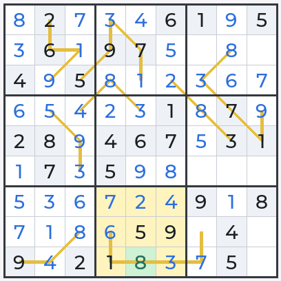

<!-- Written by tools/walkthrough.py dutch-whispers: edit the script, not this page. -->
# Dutch Whispers, step 44: the 8 in box 8

**Step 44 of 52** · [← Step 43](step-43.md) · [All steps](../dutch-whispers.md#the-whole-puzzle-step-by-step) · [Step 45 →](step-45.md)

Box 8 needs an 8, and r9c5 is its last empty cell: **r9c5 = 8**.

**Step 44 of 52** · [← Step 43](step-43.md) · [All steps](../dutch-whispers.md#the-whole-puzzle-step-by-step) · [Step 45 →](step-45.md)
