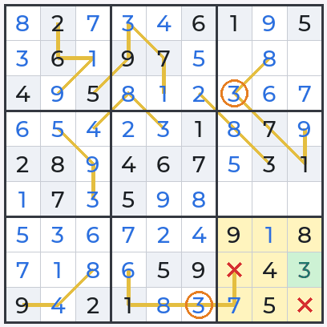

<!-- Written by tools/walkthrough.py dutch-whispers: edit the script, not this page. -->
# Dutch Whispers, step 45: the 3 in box 9

**Step 45 of 52** · [← Step 44](step-44.md) · [All steps](../dutch-whispers.md#the-whole-puzzle-step-by-step) · [Step 46 →](step-46.md)

Box 9 needs a 3. r8c7: column 7 has one (r3c7). r9c9: row 9 has one (r9c6). Only **r8c9** is left: **r8c9 = 3**.

**Step 45 of 52** · [← Step 44](step-44.md) · [All steps](../dutch-whispers.md#the-whole-puzzle-step-by-step) · [Step 46 →](step-46.md)
