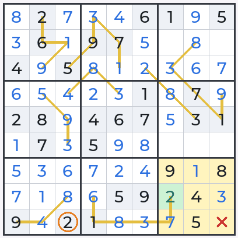

<!-- Written by tools/walkthrough.py dutch-whispers: edit the script, not this page. -->
# Dutch Whispers, step 46: the 2 in box 9

**Step 46 of 52** · [← Step 45](step-45.md) · [All steps](../dutch-whispers.md#the-whole-puzzle-step-by-step) · [Step 47 →](step-47.md)

Box 9 needs a 2. r9c9: row 9 has one (r9c3). Only **r8c7** is left: **r8c7 = 2**.

**Step 46 of 52** · [← Step 45](step-45.md) · [All steps](../dutch-whispers.md#the-whole-puzzle-step-by-step) · [Step 47 →](step-47.md)
