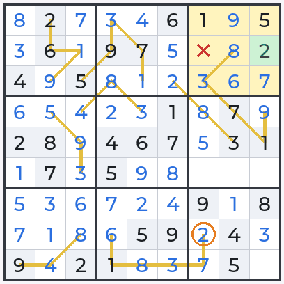

<!-- Written by tools/walkthrough.py dutch-whispers: edit the script, not this page. -->
# Dutch Whispers, step 47: the 2 in box 3

**Step 47 of 52** · [← Step 46](step-46.md) · [All steps](../dutch-whispers.md#the-whole-puzzle-step-by-step) · [Step 48 →](step-48.md)

Box 3 needs a 2. r2c7: column 7 has one (r8c7). Only **r2c9** is left: **r2c9 = 2**.

**Step 47 of 52** · [← Step 46](step-46.md) · [All steps](../dutch-whispers.md#the-whole-puzzle-step-by-step) · [Step 48 →](step-48.md)
