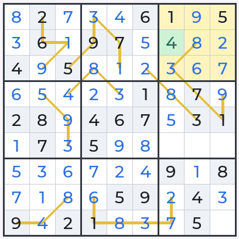

<!-- Written by tools/walkthrough.py dutch-whispers: edit the script, not this page. -->
# Dutch Whispers, step 48: the 4 in box 3

**Step 48 of 52** · [← Step 47](step-47.md) · [All steps](../dutch-whispers.md#the-whole-puzzle-step-by-step) · [Step 49 →](step-49.md)

Box 3 needs a 4, and r2c7 is its last empty cell: **r2c7 = 4**.

**Step 48 of 52** · [← Step 47](step-47.md) · [All steps](../dutch-whispers.md#the-whole-puzzle-step-by-step) · [Step 49 →](step-49.md)
