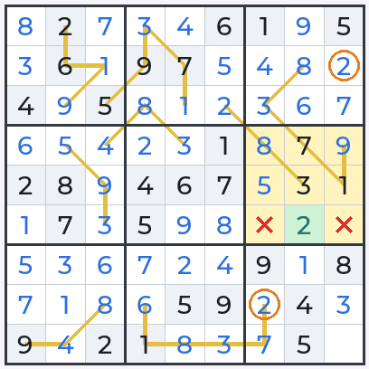

<!-- Written by tools/walkthrough.py dutch-whispers: edit the script, not this page. -->
# Dutch Whispers, step 49: the 2 in box 6

**Step 49 of 52** · [← Step 48](step-48.md) · [All steps](../dutch-whispers.md#the-whole-puzzle-step-by-step) · [Step 50 →](step-50.md)

Box 6 needs a 2. r6c7: column 7 has one (r8c7). r6c9: column 9 has one (r2c9). Only **r6c8** is left: **r6c8 = 2**.

**Step 49 of 52** · [← Step 48](step-48.md) · [All steps](../dutch-whispers.md#the-whole-puzzle-step-by-step) · [Step 50 →](step-50.md)
