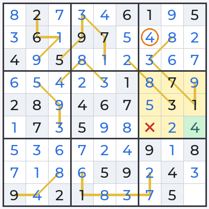

<!-- Written by tools/walkthrough.py dutch-whispers: edit the script, not this page. -->
# Dutch Whispers, step 50: the 4 in box 6

**Step 50 of 52** · [← Step 49](step-49.md) · [All steps](../dutch-whispers.md#the-whole-puzzle-step-by-step) · [Step 51 →](step-51.md)

Box 6 needs a 4. r6c7: column 7 has one (r2c7). Only **r6c9** is left: **r6c9 = 4**.

**Step 50 of 52** · [← Step 49](step-49.md) · [All steps](../dutch-whispers.md#the-whole-puzzle-step-by-step) · [Step 51 →](step-51.md)
