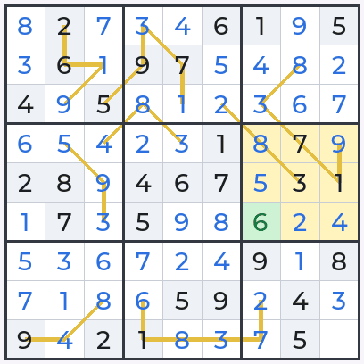

<!-- Written by tools/walkthrough.py dutch-whispers: edit the script, not this page. -->
# Dutch Whispers, step 51: the 6 in box 6

**Step 51 of 52** · [← Step 50](step-50.md) · [All steps](../dutch-whispers.md#the-whole-puzzle-step-by-step) · [Step 52 →](step-52.md)

Box 6 needs a 6, and r6c7 is its last empty cell: **r6c7 = 6**.

**Step 51 of 52** · [← Step 50](step-50.md) · [All steps](../dutch-whispers.md#the-whole-puzzle-step-by-step) · [Step 52 →](step-52.md)
