# Entropic Lines

[← All variants](README.md) · [Puzzles](../features-puzzles.md) · [How to play](../how-to-play.md)

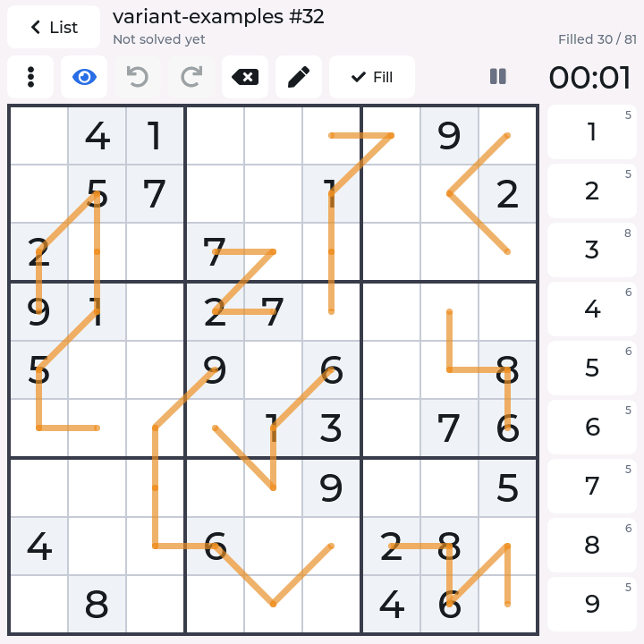

## The rules

[Classic](classic.md) rules, plus **orange lines** through cells side by side or diagonal. The digits fall into three groups: **low** (1, 2, 3), **middle** (4, 5, 6) and **high** (7, 8, 9). **Any three cells in a row on a line hold one digit of each group**, in any order: 2, 9, 4, 1, 8 works, since 2 9 4, 9 4 1 and 4 1 8 each have a low, a middle and a high digit.

It follows that **cells three apart on a line are in the same group**: on 2, 9, 4, 1, 8 the 2 and the 1 are both low, the 9 and the 8 both high.

## On the board

- Each line is a narrow orange line under the digits.
- Two digits on a line that break the rule turn red: three apart in different groups, or closer together in the same group.
- The grader and hints work out, for each third of the line (its 1st, 4th, 7th cells; its 2nd, 5th, 8th; its 3rd, 6th, 9th), which groups it can still be, and give the thirds three different groups: "Any three cells in a row on this line hold a low (1-3), a middle (4-6) and a high (7-9) digit, so row 4, column 2 can only be 1".
- **Puzzles → ⋮ → New puzzle → Lines → Entropic**: 8 lines (Hard and Expert 10) of 3 to 8 cells.

## How to solve it

- **Every third cell matches:** once a cell's group is known, so is the group of every cell 3, 6 ... along from it.
- **Two groups known, the third follows:** if two cells side by side are low and high, the cells next to them are middle.
- **Each group is three digits:** a cell known to be middle is 4, 5 or 6, and its row, column and box often pick one.
- **Short lines say the least:** a line of three only says its cells are one of each group.

## Worked example

**variant-examples #32**, Entropic Lines Easy (see [Classic](classic.md#worked-example-the-whole-puzzle) for how to import the examples; cells are written r*row*c*column*). The lines are in the screenshot; two matter here:

- a line of **seven**: r8c6, r9c5, r8c4 (a 6), r8c3, r7c3, r6c3 and r5c4 (a 9);
- a line of **eight**: r6c2, r6c1, r5c1 (a 5), r4c2 (a 1), r3c2, r2c2 (a 5), r3c1 (a 2) and r4c1 (a 9).

**Step 1: r8c6, the start of the line of seven.** Row 8 has 2, 4, 6 and 8; column 6 has 1, 3, 6 and 9: that leaves 5 and 7. It is the line's 1st cell; its 7th, six cells along, is a 9: high. So r8c6 is high too. **r8c6 = 7**.

**Step 2: r3c2, the 5th cell of the line of eight.** Row 3 has 2 and 7; column 2 has 1, 4, 5 and 8: that leaves 3, 6 and 9. Three cells along is the 8th, r4c1, a 9: high. **r3c2 = 9**.

**Step 3: r6c3, the 6th cell of the line of seven.** Row 6 has 1, 3, 6 and 7; box 4 has 1, 5 and 9: that leaves 2, 4 and 8. Three cells back is the 3rd, r8c4, a 6: middle. **r6c3 = 4**.

## The whole puzzle, step by step

<!-- walkthrough -->
<!-- Written by tools/walkthrough.py entropic-lines: edit the script, not this part. -->

The whole puzzle, from the start to the last cell: 51 steps, each one a single (one place left for a digit, or one digit left for a cell), taken in the order a box's single comes first, so not quite the order of the worked example above. In each picture, the unit the step looks at is tinted yellow (for a cell with one digit left: its row, column and box), the new digit is on green, the digits that rule cells out have an **orange ring**, and the empty cells they rule out a **red cross**. Givens are on grey, digits from earlier steps in blue.

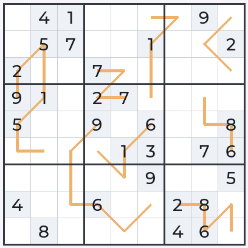

#### Step 1: the 2 in box 2

Box 2 needs a 2. r1c4: column 4 has one (r4c4). r2c4 and r2c5: row 2 has one (r2c9). r3c5 and r3c6: row 3 has one (r3c1). r1c6: next to it on its orange line there's a low (1-3) digit already, and three in a row need one of each. Only **r1c5** is left: **r1c5 = 2**.

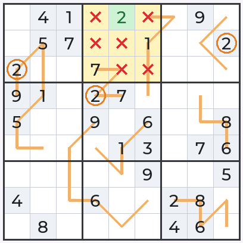

#### Step 2: the 9 in box 2

Box 2 needs a 9. r1c4 and r1c6: row 1 has one (r1c8). r2c4: column 4 has one (r5c4). r3c6: column 6 has one (r7c6). r3c5: next to it on its orange line there's a low (1-3) and a high (7-9) digit already, and three in a row need one of each. Only **r2c5** is left: **r2c5 = 9**.

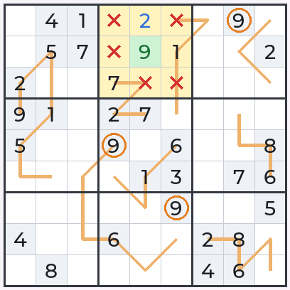

#### Step 3: the 6 in box 2

Box 2 needs a 6. r1c4 and r2c4: column 4 has one (r8c4). r1c6 and r3c6: column 6 has one (r5c6). Only **r3c5** is left: **r3c5 = 6**.

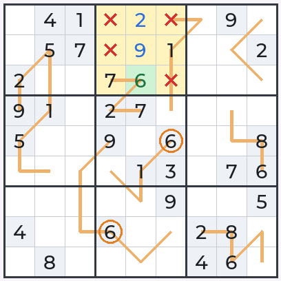

#### Step 4: the 6 in box 4

Box 4 needs a 6. r5c2 and r5c3: row 5 has one (r5c6). r6c1, r6c2 and r6c3: row 6 has one (r6c9). Only **r4c3** is left: **r4c3 = 6**.

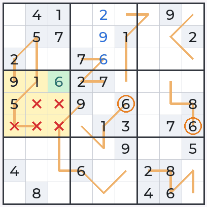

#### Step 5: the 7 in box 4

Box 4 needs a 7. r5c3: column 3 has one (r2c3). r6c1, r6c2 and r6c3: row 6 has one (r6c8). Only **r5c2** is left: **r5c2 = 7**.

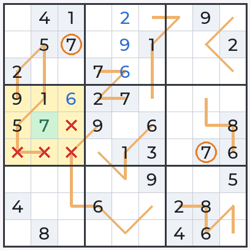

#### Step 6: the 3 in box 4

Box 4 needs a 3. r6c1, r6c2 and r6c3: row 6 has one (r6c6). Only **r5c3** is left: **r5c3 = 3**.

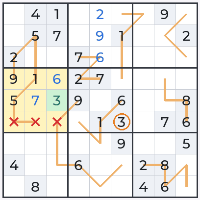

#### Step 7: the 2 in box 4

Box 4 needs a 2. r6c1: column 1 has one (r3c1). r6c3: it's 3 cells from the 6 in r8c4 along its orange line, so it's middle (4-6) like it. Only **r6c2** is left: **r6c2 = 2**.

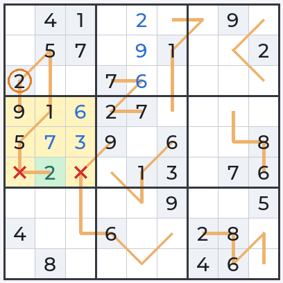

#### Step 8: the 4 in box 4

Box 4 needs a 4. r6c1: column 1 has one (r8c1). Only **r6c3** is left: **r6c3 = 4**.

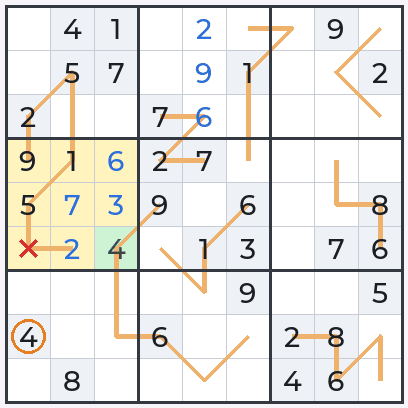

#### Step 9: the 8 in box 4

Box 4 needs an 8, and r6c1 is its last empty cell: **r6c1 = 8**.

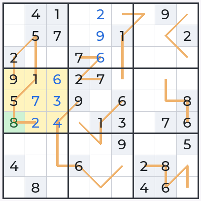

#### Step 10: the 8 in box 1

Box 1 needs an 8. r1c1 and r2c1: column 1 has one (r6c1). r3c2: column 2 has one (r9c2). Only **r3c3** is left: **r3c3 = 8**.

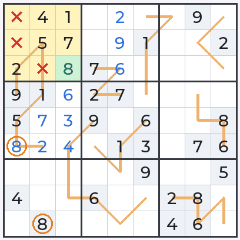

#### Step 11: the 9 in box 1

Box 1 needs a 9. r1c1: row 1 has one (r1c8). r2c1: row 2 has one (r2c5). Only **r3c2** is left: **r3c2 = 9**.

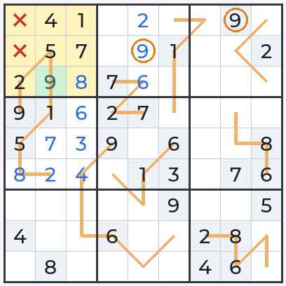

#### Step 12: the 8 in box 5

Box 5 needs an 8. r5c5: row 5 has one (r5c9). r6c4: row 6 has one (r6c1). Only **r4c6** is left: **r4c6 = 8**.

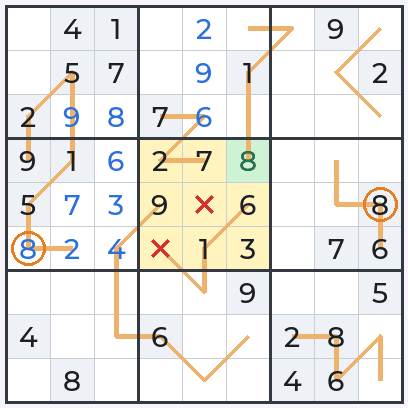

#### Step 13: the 6 in box 3

Box 3 needs a 6. r1c9: column 9 has one (r6c9). r2c8: column 8 has one (r9c8). r3c7, r3c8 and r3c9: row 3 has one (r3c5). r1c7: it's 3 cells from the 8 in r4c6 along its orange line, so it's high (7-9) like it. Only **r2c7** is left: **r2c7 = 6**.

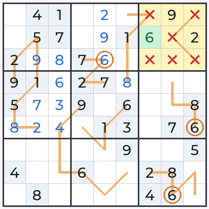

#### Step 14: the 6 in box 1

Box 1 needs a 6. r2c1: row 2 has one (r2c7). Only **r1c1** is left: **r1c1 = 6**.

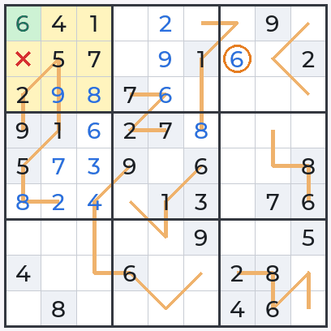

#### Step 15: the 3 in box 1

Box 1 needs a 3, and r2c1 is its last empty cell: **r2c1 = 3**.

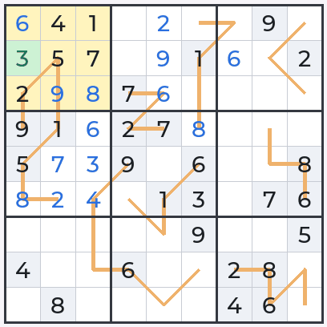

#### Step 16: the 3 in box 2

Box 2 needs a 3. r1c6 and r3c6: column 6 has one (r6c6). r2c4: row 2 has one (r2c1). Only **r1c4** is left: **r1c4 = 3**.

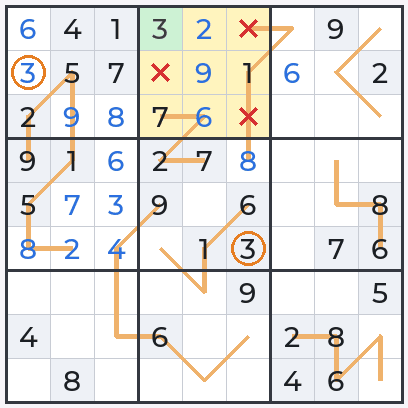

#### Step 17: the 8 in box 2

Box 2 needs an 8. r1c6: column 6 has one (r4c6). r3c6: row 3 has one (r3c3). Only **r2c4** is left: **r2c4 = 8**.

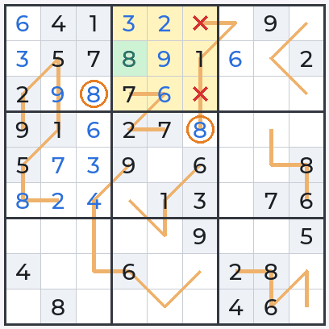

#### Step 18: the 4 in box 2

Box 2 needs a 4. r1c6: row 1 has one (r1c2). Only **r3c6** is left: **r3c6 = 4**.

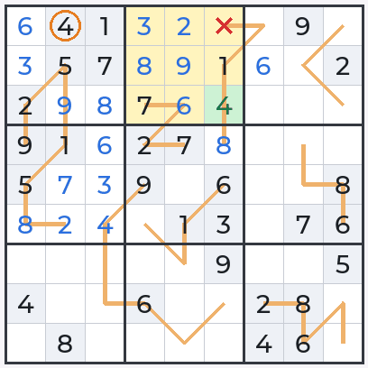

#### Step 19: the 5 in box 2

Box 2 needs a 5, and r1c6 is its last empty cell: **r1c6 = 5**.

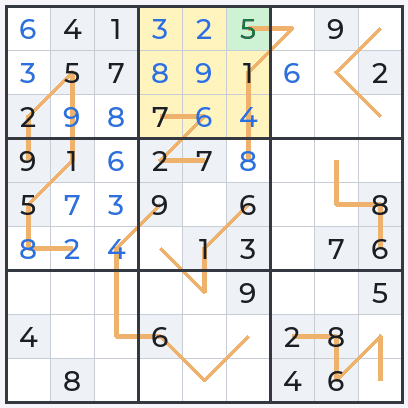

#### Step 20: the 4 in box 3

Box 3 needs a 4. r1c7 and r1c9: row 1 has one (r1c2). r3c7, r3c8 and r3c9: row 3 has one (r3c6). Only **r2c8** is left: **r2c8 = 4**.

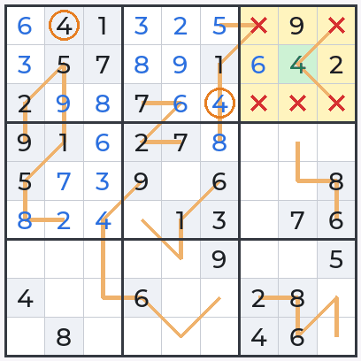

#### Step 21: the 8 in box 3

Box 3 needs an 8. r1c9: column 9 has one (r5c9). r3c7, r3c8 and r3c9: row 3 has one (r3c3). Only **r1c7** is left: **r1c7 = 8**.

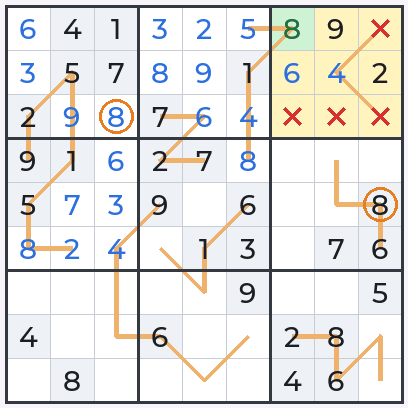

#### Step 22: the 7 in box 3

Box 3 needs a 7. r3c7, r3c8 and r3c9: row 3 has one (r3c4). Only **r1c9** is left: **r1c9 = 7**.

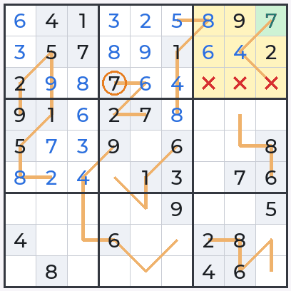

#### Step 23: the 4 in box 5

Box 5 needs a 4. r6c4: row 6 has one (r6c3). Only **r5c5** is left: **r5c5 = 4**.

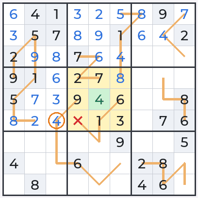

#### Step 24: the 5 in box 5

Box 5 needs a 5, and r6c4 is its last empty cell: **r6c4 = 5**.

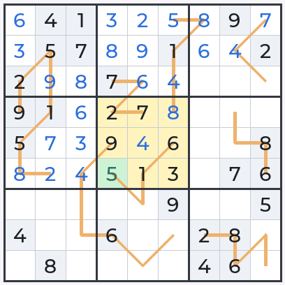

#### Step 25: the 2 in box 6

Box 6 needs a 2. r4c7, r4c8 and r4c9: row 4 has one (r4c4). r5c7: column 7 has one (r8c7). r6c7: row 6 has one (r6c2). Only **r5c8** is left: **r5c8 = 2**.

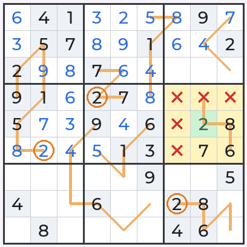

#### Step 26: the 1 in box 6

Box 6 needs a 1. r4c7, r4c8 and r4c9: row 4 has one (r4c2). r6c7: row 6 has one (r6c5). Only **r5c7** is left: **r5c7 = 1**.

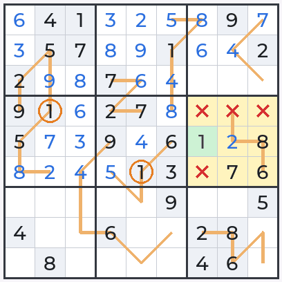

#### Step 27: the 4 in box 6

Box 6 needs a 4. r4c7: column 7 has one (r9c7). r4c8: column 8 has one (r2c8). r6c7: row 6 has one (r6c3). Only **r4c9** is left: **r4c9 = 4**.

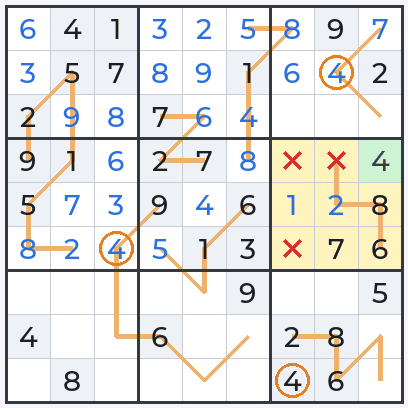

#### Step 28: the 3 in box 6

Box 6 needs a 3. r6c7: row 6 has one (r6c6). r4c8: it's 3 cells from the 6 in r6c9 along its orange line, so it's middle (4-6) like it. Only **r4c7** is left: **r4c7 = 3**.

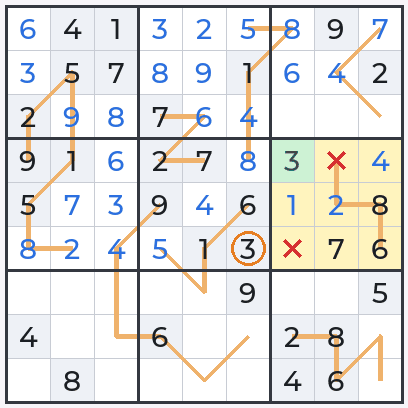

#### Step 29: the 5 in box 6

Box 6 needs a 5. r6c7: row 6 has one (r6c4). Only **r4c8** is left: **r4c8 = 5**.

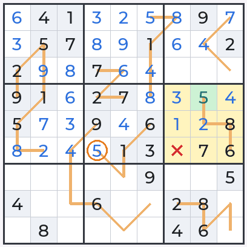

#### Step 30: the 5 in box 3

Box 3 needs a 5. r3c8: column 8 has one (r4c8). r3c9: column 9 has one (r7c9). Only **r3c7** is left: **r3c7 = 5**.

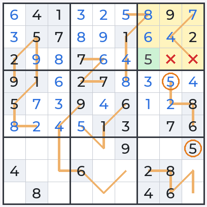

#### Step 31: the 9 in box 6

Box 6 needs a 9, and r6c7 is its last empty cell: **r6c7 = 9**.

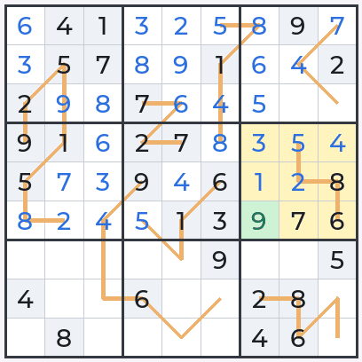

#### Step 32: the 5 in box 7

Box 7 needs a 5. r7c1, r7c2 and r7c3: row 7 has one (r7c9). r8c2: column 2 has one (r2c2). r9c1: column 1 has one (r5c1). r8c3: it's 3 cells from the 9 in r5c4 along its orange line, so it's high (7-9) like it. Only **r9c3** is left: **r9c3 = 5**.

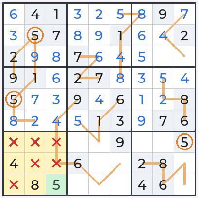

#### Step 33: the 2 in box 7

Box 7 needs a 2. r7c1 and r9c1: column 1 has one (r3c1). r7c2: column 2 has one (r6c2). r8c2 and r8c3: row 8 has one (r8c7). Only **r7c3** is left: **r7c3 = 2**.

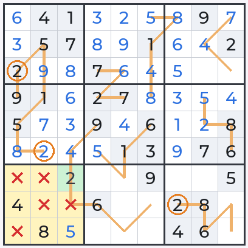

#### Step 34: the 6 in box 7

Box 7 needs a 6. r7c1: column 1 has one (r1c1). r8c2 and r8c3: row 8 has one (r8c4). r9c1: row 9 has one (r9c8). Only **r7c2** is left: **r7c2 = 6**.

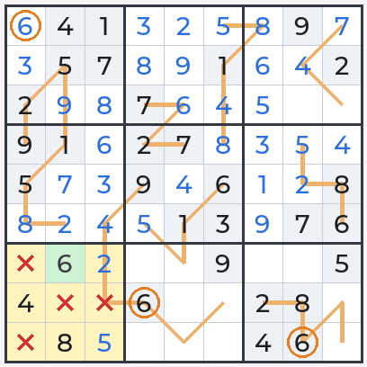

#### Step 35: the 3 in box 7

Box 7 needs a 3. r7c1 and r9c1: column 1 has one (r2c1). r8c3: column 3 has one (r5c3). Only **r8c2** is left: **r8c2 = 3**.

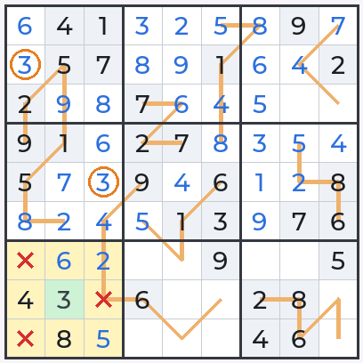

#### Step 36: the 9 in box 7

Box 7 needs a 9. r7c1: row 7 has one (r7c6). r9c1: column 1 has one (r4c1). Only **r8c3** is left: **r8c3 = 9**.

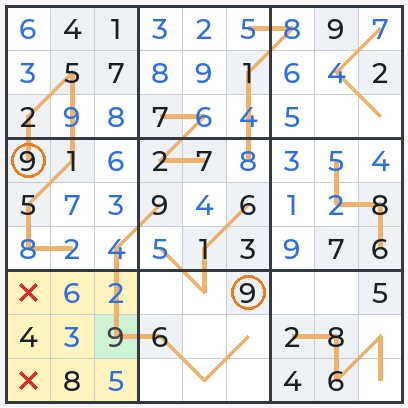

#### Step 37: the 2 in box 8

Box 8 needs a 2. r7c4 and r7c5: row 7 has one (r7c3). r8c5 and r8c6: row 8 has one (r8c7). r9c4: column 4 has one (r4c4). r9c5: column 5 has one (r1c5). Only **r9c6** is left: **r9c6 = 2**.

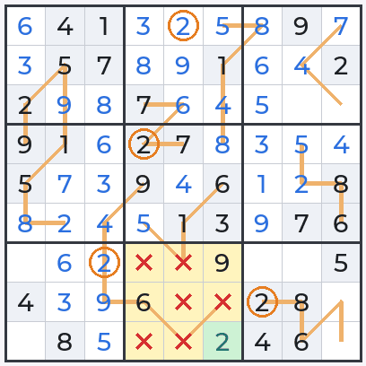

#### Step 38: the 3 in box 8

Box 8 needs a 3. r7c4 and r9c4: column 4 has one (r1c4). r8c5 and r8c6: row 8 has one (r8c2). r7c5: next to it on its orange line there's a low (1-3) and a middle (4-6) digit already, and three in a row need one of each. Only **r9c5** is left: **r9c5 = 3**.

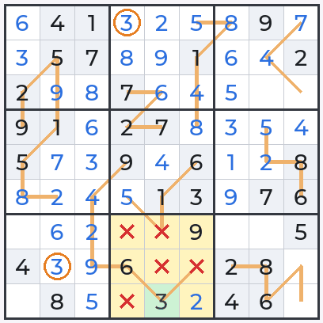

#### Step 39: the 4 in box 8

Box 8 needs a 4. r7c5: column 5 has one (r5c5). r8c5 and r8c6: row 8 has one (r8c1). r9c4: row 9 has one (r9c7). Only **r7c4** is left: **r7c4 = 4**.

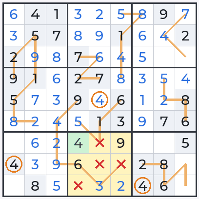

#### Step 40: the 1 in box 8

Box 8 needs a 1. r7c5 and r8c5: column 5 has one (r6c5). r8c6: column 6 has one (r2c6). Only **r9c4** is left: **r9c4 = 1**.

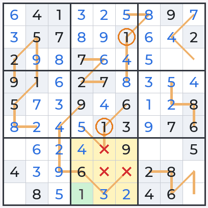

#### Step 41: the 1 in box 7

Box 7 needs a 1. r9c1: row 9 has one (r9c4). Only **r7c1** is left: **r7c1 = 1**.

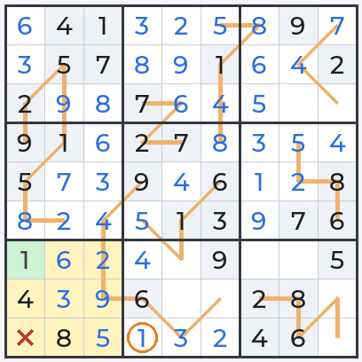

#### Step 42: the 7 in box 7

Box 7 needs a 7, and r9c1 is its last empty cell: **r9c1 = 7**.

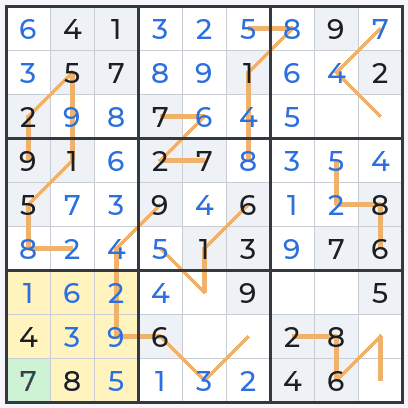

#### Step 43: the 5 in box 8

Box 8 needs a 5. r7c5: row 7 has one (r7c9). r8c6: column 6 has one (r1c6). Only **r8c5** is left: **r8c5 = 5**.

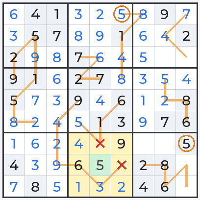

#### Step 44: the 7 in box 8

Box 8 needs a 7. r7c5: column 5 has one (r4c5). Only **r8c6** is left: **r8c6 = 7**.

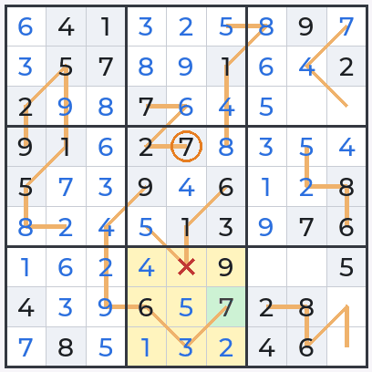

#### Step 45: the 8 in box 8

Box 8 needs an 8, and r7c5 is its last empty cell: **r7c5 = 8**.

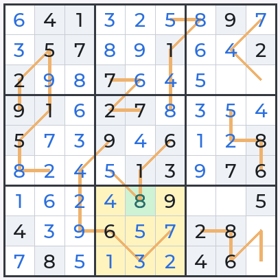

#### Step 46: the 1 in box 9

Box 9 needs a 1. r7c7 and r7c8: row 7 has one (r7c1). r9c9: row 9 has one (r9c4). Only **r8c9** is left: **r8c9 = 1**.

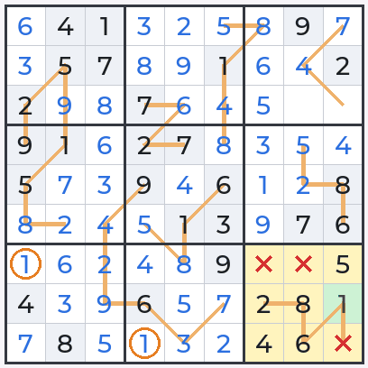

#### Step 47: the 1 in box 3

Box 3 needs a 1. r3c9: column 9 has one (r8c9). Only **r3c8** is left: **r3c8 = 1**.

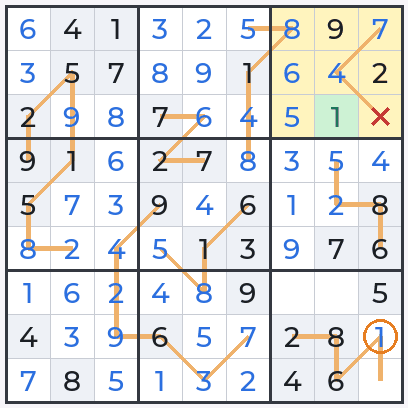

#### Step 48: the 3 in box 3

Box 3 needs a 3, and r3c9 is its last empty cell: **r3c9 = 3**.

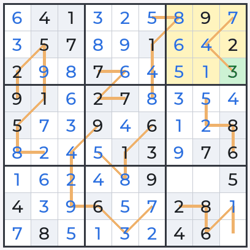

#### Step 49: the 3 in box 9

Box 9 needs a 3. r7c7: column 7 has one (r4c7). r9c9: row 9 has one (r9c5). Only **r7c8** is left: **r7c8 = 3**.

#### Step 50: the 7 in box 9

Box 9 needs a 7. r9c9: row 9 has one (r9c1). Only **r7c7** is left: **r7c7 = 7**.

#### Step 51: the 9 in box 9

Box 9 needs a 9, and r9c9 is its last empty cell: **r9c9 = 9**.

Solved.

<!-- /walkthrough -->
