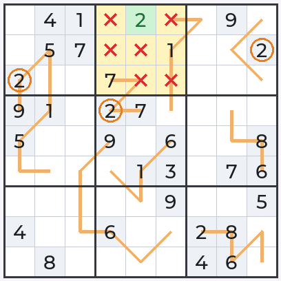

<!-- Written by tools/walkthrough.py entropic-lines: edit the script, not this page. -->
# Entropic Lines, step 1: the 2 in box 2

**Step 1 of 51** · [← The start](../entropic-lines.md#the-whole-puzzle-step-by-step) · [All steps](../entropic-lines.md#the-whole-puzzle-step-by-step) · [Step 2 →](step-02.md)

Box 2 needs a 2. r1c4: column 4 has one (r4c4). r2c4 and r2c5: row 2 has one (r2c9). r3c5 and r3c6: row 3 has one (r3c1). r1c6: next to it on its orange line there's a low (1-3) digit already, and three in a row need one of each. Only **r1c5** is left: **r1c5 = 2**.

**Step 1 of 51** · [← The start](../entropic-lines.md#the-whole-puzzle-step-by-step) · [All steps](../entropic-lines.md#the-whole-puzzle-step-by-step) · [Step 2 →](step-02.md)
