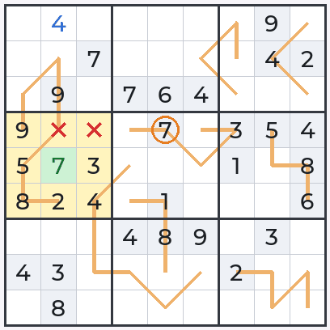

<!-- Written by tools/walkthrough.py entropic-lines: edit the script, not this page. -->
# Entropic Lines, step 2: the 9 in box 2

**Step 2 of 51** · [← Step 1](step-01.md) · [All steps](../entropic-lines.md#the-whole-puzzle-step-by-step) · [Step 3 →](step-03.md)

Box 2 needs a 9. r1c4 and r1c6: row 1 has one (r1c8). r2c4: column 4 has one (r5c4). r3c6: column 6 has one (r7c6). r3c5: next to it on its orange line there's a low (1-3) and a high (7-9) digit already, and three in a row need one of each. Only **r2c5** is left: **r2c5 = 9**.

**Step 2 of 51** · [← Step 1](step-01.md) · [All steps](../entropic-lines.md#the-whole-puzzle-step-by-step) · [Step 3 →](step-03.md)
