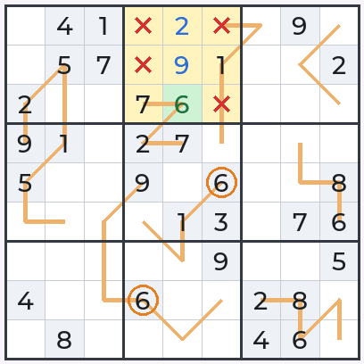

<!-- Written by tools/walkthrough.py entropic-lines: edit the script, not this page. -->
# Entropic Lines, step 3: the 6 in box 2

**Step 3 of 51** · [← Step 2](step-02.md) · [All steps](../entropic-lines.md#the-whole-puzzle-step-by-step) · [Step 4 →](step-04.md)

Box 2 needs a 6. r1c4 and r2c4: column 4 has one (r8c4). r1c6 and r3c6: column 6 has one (r5c6). Only **r3c5** is left: **r3c5 = 6**.

**Step 3 of 51** · [← Step 2](step-02.md) · [All steps](../entropic-lines.md#the-whole-puzzle-step-by-step) · [Step 4 →](step-04.md)
