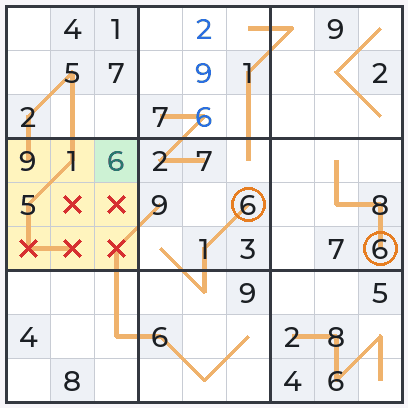

<!-- Written by tools/walkthrough.py entropic-lines: edit the script, not this page. -->
# Entropic Lines, step 4: the 6 in box 4

**Step 4 of 51** · [← Step 3](step-03.md) · [All steps](../entropic-lines.md#the-whole-puzzle-step-by-step) · [Step 5 →](step-05.md)

Box 4 needs a 6. r5c2 and r5c3: row 5 has one (r5c6). r6c1, r6c2 and r6c3: row 6 has one (r6c9). Only **r4c3** is left: **r4c3 = 6**.

**Step 4 of 51** · [← Step 3](step-03.md) · [All steps](../entropic-lines.md#the-whole-puzzle-step-by-step) · [Step 5 →](step-05.md)
