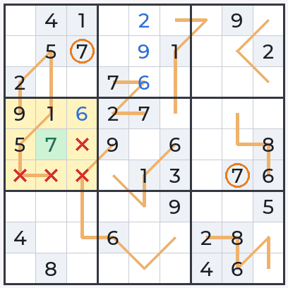

<!-- Written by tools/walkthrough.py entropic-lines: edit the script, not this page. -->
# Entropic Lines, step 5: the 7 in box 4

**Step 5 of 51** · [← Step 4](step-04.md) · [All steps](../entropic-lines.md#the-whole-puzzle-step-by-step) · [Step 6 →](step-06.md)

Box 4 needs a 7. r5c3: column 3 has one (r2c3). r6c1, r6c2 and r6c3: row 6 has one (r6c8). Only **r5c2** is left: **r5c2 = 7**.

**Step 5 of 51** · [← Step 4](step-04.md) · [All steps](../entropic-lines.md#the-whole-puzzle-step-by-step) · [Step 6 →](step-06.md)
