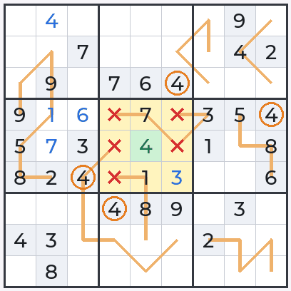

<!-- Written by tools/walkthrough.py entropic-lines: edit the script, not this page. -->
# Entropic Lines, step 6: the 3 in box 4

**Step 6 of 51** · [← Step 5](step-05.md) · [All steps](../entropic-lines.md#the-whole-puzzle-step-by-step) · [Step 7 →](step-07.md)

Box 4 needs a 3. r6c1, r6c2 and r6c3: row 6 has one (r6c6). Only **r5c3** is left: **r5c3 = 3**.

**Step 6 of 51** · [← Step 5](step-05.md) · [All steps](../entropic-lines.md#the-whole-puzzle-step-by-step) · [Step 7 →](step-07.md)
