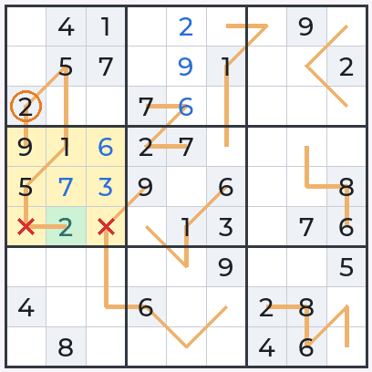

<!-- Written by tools/walkthrough.py entropic-lines: edit the script, not this page. -->
# Entropic Lines, step 7: the 2 in box 4

**Step 7 of 51** · [← Step 6](step-06.md) · [All steps](../entropic-lines.md#the-whole-puzzle-step-by-step) · [Step 8 →](step-08.md)

Box 4 needs a 2. r6c1: column 1 has one (r3c1). r6c3: it's 3 cells from the 6 in r8c4 along its orange line, so it's middle (4-6) like it. Only **r6c2** is left: **r6c2 = 2**.

**Step 7 of 51** · [← Step 6](step-06.md) · [All steps](../entropic-lines.md#the-whole-puzzle-step-by-step) · [Step 8 →](step-08.md)
