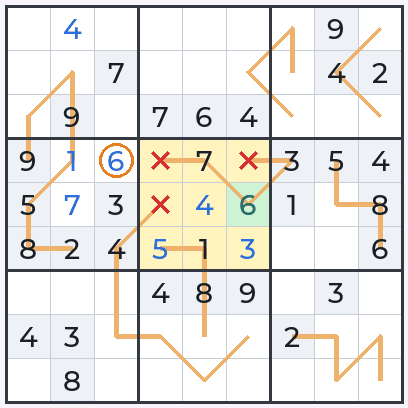

<!-- Written by tools/walkthrough.py entropic-lines: edit the script, not this page. -->
# Entropic Lines, step 8: the 4 in box 4

**Step 8 of 51** · [← Step 7](step-07.md) · [All steps](../entropic-lines.md#the-whole-puzzle-step-by-step) · [Step 9 →](step-09.md)

Box 4 needs a 4. r6c1: column 1 has one (r8c1). Only **r6c3** is left: **r6c3 = 4**.

**Step 8 of 51** · [← Step 7](step-07.md) · [All steps](../entropic-lines.md#the-whole-puzzle-step-by-step) · [Step 9 →](step-09.md)
