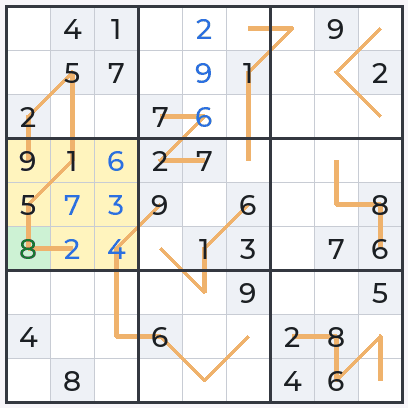

<!-- Written by tools/walkthrough.py entropic-lines: edit the script, not this page. -->
# Entropic Lines, step 9: the 8 in box 4

**Step 9 of 51** · [← Step 8](step-08.md) · [All steps](../entropic-lines.md#the-whole-puzzle-step-by-step) · [Step 10 →](step-10.md)

Box 4 needs an 8, and r6c1 is its last empty cell: **r6c1 = 8**.

**Step 9 of 51** · [← Step 8](step-08.md) · [All steps](../entropic-lines.md#the-whole-puzzle-step-by-step) · [Step 10 →](step-10.md)
