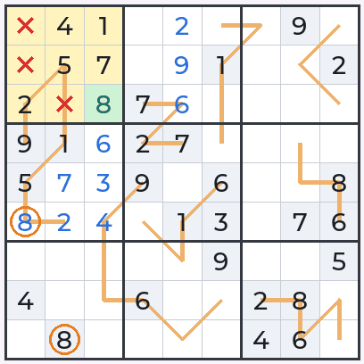

<!-- Written by tools/walkthrough.py entropic-lines: edit the script, not this page. -->
# Entropic Lines, step 10: the 8 in box 1

**Step 10 of 51** · [← Step 9](step-09.md) · [All steps](../entropic-lines.md#the-whole-puzzle-step-by-step) · [Step 11 →](step-11.md)

Box 1 needs an 8. r1c1 and r2c1: column 1 has one (r6c1). r3c2: column 2 has one (r9c2). Only **r3c3** is left: **r3c3 = 8**.

**Step 10 of 51** · [← Step 9](step-09.md) · [All steps](../entropic-lines.md#the-whole-puzzle-step-by-step) · [Step 11 →](step-11.md)
