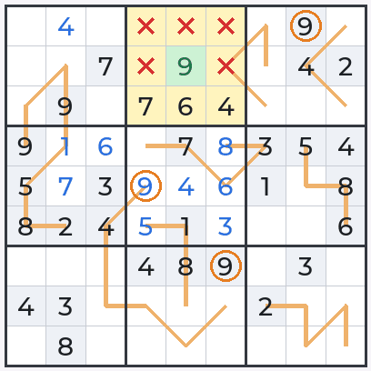

<!-- Written by tools/walkthrough.py entropic-lines: edit the script, not this page. -->
# Entropic Lines, step 11: the 9 in box 1

**Step 11 of 51** · [← Step 10](step-10.md) · [All steps](../entropic-lines.md#the-whole-puzzle-step-by-step) · [Step 12 →](step-12.md)

Box 1 needs a 9. r1c1: row 1 has one (r1c8). r2c1: row 2 has one (r2c5). Only **r3c2** is left: **r3c2 = 9**.

**Step 11 of 51** · [← Step 10](step-10.md) · [All steps](../entropic-lines.md#the-whole-puzzle-step-by-step) · [Step 12 →](step-12.md)
