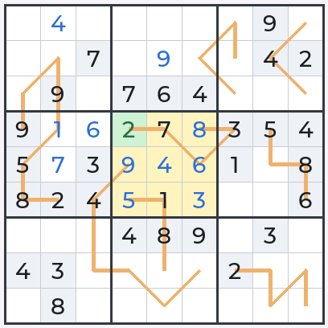

<!-- Written by tools/walkthrough.py entropic-lines: edit the script, not this page. -->
# Entropic Lines, step 12: the 8 in box 5

**Step 12 of 51** · [← Step 11](step-11.md) · [All steps](../entropic-lines.md#the-whole-puzzle-step-by-step) · [Step 13 →](step-13.md)

Box 5 needs an 8. r5c5: row 5 has one (r5c9). r6c4: row 6 has one (r6c1). Only **r4c6** is left: **r4c6 = 8**.

**Step 12 of 51** · [← Step 11](step-11.md) · [All steps](../entropic-lines.md#the-whole-puzzle-step-by-step) · [Step 13 →](step-13.md)
