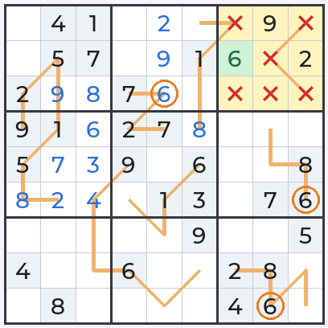

<!-- Written by tools/walkthrough.py entropic-lines: edit the script, not this page. -->
# Entropic Lines, step 13: the 6 in box 3

**Step 13 of 51** · [← Step 12](step-12.md) · [All steps](../entropic-lines.md#the-whole-puzzle-step-by-step) · [Step 14 →](step-14.md)

Box 3 needs a 6. r1c9: column 9 has one (r6c9). r2c8: column 8 has one (r9c8). r3c7, r3c8 and r3c9: row 3 has one (r3c5). r1c7: it's 3 cells from the 8 in r4c6 along its orange line, so it's high (7-9) like it. Only **r2c7** is left: **r2c7 = 6**.

**Step 13 of 51** · [← Step 12](step-12.md) · [All steps](../entropic-lines.md#the-whole-puzzle-step-by-step) · [Step 14 →](step-14.md)
