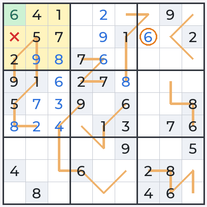

<!-- Written by tools/walkthrough.py entropic-lines: edit the script, not this page. -->
# Entropic Lines, step 14: the 6 in box 1

**Step 14 of 51** · [← Step 13](step-13.md) · [All steps](../entropic-lines.md#the-whole-puzzle-step-by-step) · [Step 15 →](step-15.md)

Box 1 needs a 6. r2c1: row 2 has one (r2c7). Only **r1c1** is left: **r1c1 = 6**.

**Step 14 of 51** · [← Step 13](step-13.md) · [All steps](../entropic-lines.md#the-whole-puzzle-step-by-step) · [Step 15 →](step-15.md)
