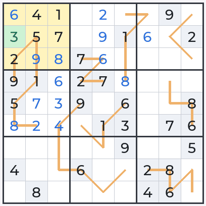

<!-- Written by tools/walkthrough.py entropic-lines: edit the script, not this page. -->
# Entropic Lines, step 15: the 3 in box 1

**Step 15 of 51** · [← Step 14](step-14.md) · [All steps](../entropic-lines.md#the-whole-puzzle-step-by-step) · [Step 16 →](step-16.md)

Box 1 needs a 3, and r2c1 is its last empty cell: **r2c1 = 3**.

**Step 15 of 51** · [← Step 14](step-14.md) · [All steps](../entropic-lines.md#the-whole-puzzle-step-by-step) · [Step 16 →](step-16.md)
