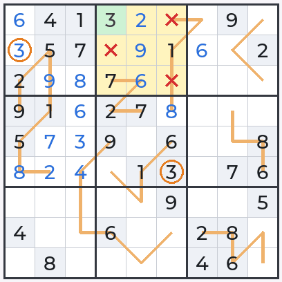

<!-- Written by tools/walkthrough.py entropic-lines: edit the script, not this page. -->
# Entropic Lines, step 16: the 3 in box 2

**Step 16 of 51** · [← Step 15](step-15.md) · [All steps](../entropic-lines.md#the-whole-puzzle-step-by-step) · [Step 17 →](step-17.md)

Box 2 needs a 3. r1c6 and r3c6: column 6 has one (r6c6). r2c4: row 2 has one (r2c1). Only **r1c4** is left: **r1c4 = 3**.

**Step 16 of 51** · [← Step 15](step-15.md) · [All steps](../entropic-lines.md#the-whole-puzzle-step-by-step) · [Step 17 →](step-17.md)
