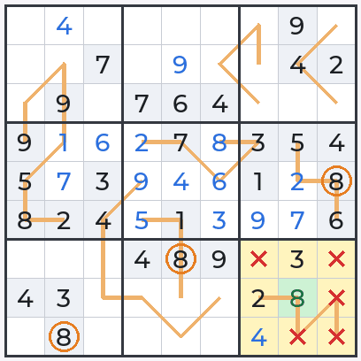

<!-- Written by tools/walkthrough.py entropic-lines: edit the script, not this page. -->
# Entropic Lines, step 17: the 8 in box 2

**Step 17 of 51** · [← Step 16](step-16.md) · [All steps](../entropic-lines.md#the-whole-puzzle-step-by-step) · [Step 18 →](step-18.md)

Box 2 needs an 8. r1c6: column 6 has one (r4c6). r3c6: row 3 has one (r3c3). Only **r2c4** is left: **r2c4 = 8**.

**Step 17 of 51** · [← Step 16](step-16.md) · [All steps](../entropic-lines.md#the-whole-puzzle-step-by-step) · [Step 18 →](step-18.md)
