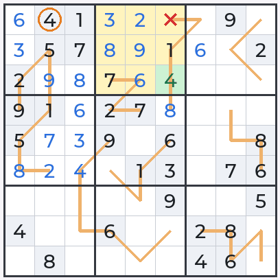

<!-- Written by tools/walkthrough.py entropic-lines: edit the script, not this page. -->
# Entropic Lines, step 18: the 4 in box 2

**Step 18 of 51** · [← Step 17](step-17.md) · [All steps](../entropic-lines.md#the-whole-puzzle-step-by-step) · [Step 19 →](step-19.md)

Box 2 needs a 4. r1c6: row 1 has one (r1c2). Only **r3c6** is left: **r3c6 = 4**.

**Step 18 of 51** · [← Step 17](step-17.md) · [All steps](../entropic-lines.md#the-whole-puzzle-step-by-step) · [Step 19 →](step-19.md)
