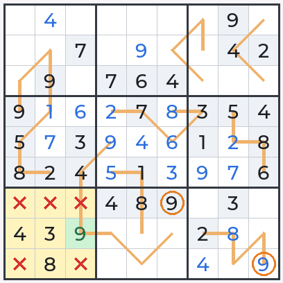

<!-- Written by tools/walkthrough.py entropic-lines: edit the script, not this page. -->
# Entropic Lines, step 19: the 5 in box 2

**Step 19 of 51** · [← Step 18](step-18.md) · [All steps](../entropic-lines.md#the-whole-puzzle-step-by-step) · [Step 20 →](step-20.md)

Box 2 needs a 5, and r1c6 is its last empty cell: **r1c6 = 5**.

**Step 19 of 51** · [← Step 18](step-18.md) · [All steps](../entropic-lines.md#the-whole-puzzle-step-by-step) · [Step 20 →](step-20.md)
