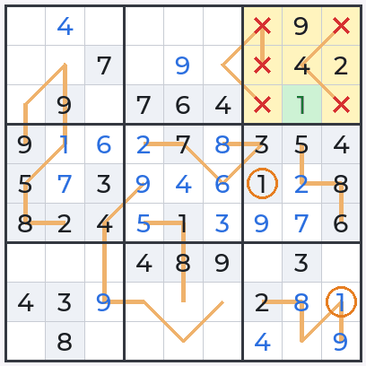

<!-- Written by tools/walkthrough.py entropic-lines: edit the script, not this page. -->
# Entropic Lines, step 21: the 8 in box 3

**Step 21 of 51** · [← Step 20](step-20.md) · [All steps](../entropic-lines.md#the-whole-puzzle-step-by-step) · [Step 22 →](step-22.md)

Box 3 needs an 8. r1c9: column 9 has one (r5c9). r3c7, r3c8 and r3c9: row 3 has one (r3c3). Only **r1c7** is left: **r1c7 = 8**.

**Step 21 of 51** · [← Step 20](step-20.md) · [All steps](../entropic-lines.md#the-whole-puzzle-step-by-step) · [Step 22 →](step-22.md)
