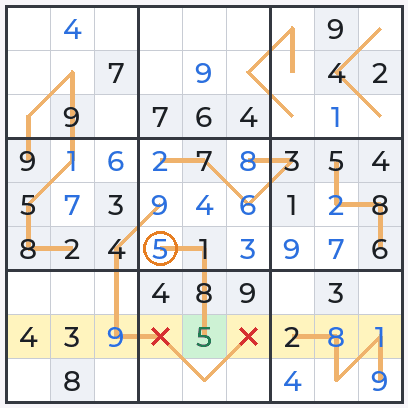

<!-- Written by tools/walkthrough.py entropic-lines: edit the script, not this page. -->
# Entropic Lines, step 22: the 7 in box 3

**Step 22 of 51** · [← Step 21](step-21.md) · [All steps](../entropic-lines.md#the-whole-puzzle-step-by-step) · [Step 23 →](step-23.md)

Box 3 needs a 7. r3c7, r3c8 and r3c9: row 3 has one (r3c4). Only **r1c9** is left: **r1c9 = 7**.

**Step 22 of 51** · [← Step 21](step-21.md) · [All steps](../entropic-lines.md#the-whole-puzzle-step-by-step) · [Step 23 →](step-23.md)
