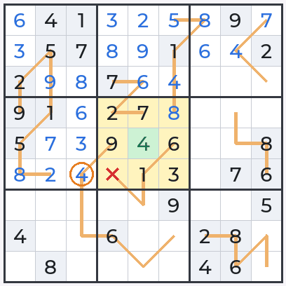

<!-- Written by tools/walkthrough.py entropic-lines: edit the script, not this page. -->
# Entropic Lines, step 23: the 4 in box 5

**Step 23 of 51** · [← Step 22](step-22.md) · [All steps](../entropic-lines.md#the-whole-puzzle-step-by-step) · [Step 24 →](step-24.md)

Box 5 needs a 4. r6c4: row 6 has one (r6c3). Only **r5c5** is left: **r5c5 = 4**.

**Step 23 of 51** · [← Step 22](step-22.md) · [All steps](../entropic-lines.md#the-whole-puzzle-step-by-step) · [Step 24 →](step-24.md)
