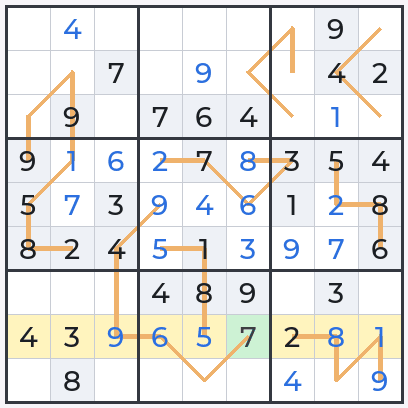

<!-- Written by tools/walkthrough.py entropic-lines: edit the script, not this page. -->
# Entropic Lines, step 24: the 5 in box 5

**Step 24 of 51** · [← Step 23](step-23.md) · [All steps](../entropic-lines.md#the-whole-puzzle-step-by-step) · [Step 25 →](step-25.md)

Box 5 needs a 5, and r6c4 is its last empty cell: **r6c4 = 5**.

**Step 24 of 51** · [← Step 23](step-23.md) · [All steps](../entropic-lines.md#the-whole-puzzle-step-by-step) · [Step 25 →](step-25.md)
