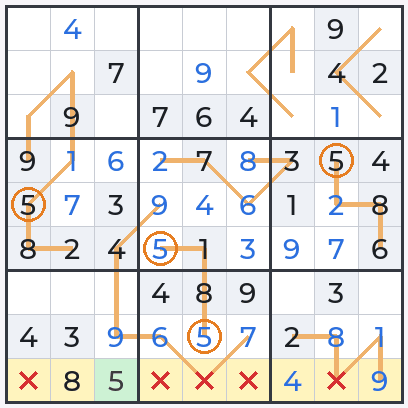

<!-- Written by tools/walkthrough.py entropic-lines: edit the script, not this page. -->
# Entropic Lines, step 25: the 2 in box 6

**Step 25 of 51** · [← Step 24](step-24.md) · [All steps](../entropic-lines.md#the-whole-puzzle-step-by-step) · [Step 26 →](step-26.md)

Box 6 needs a 2. r4c7, r4c8 and r4c9: row 4 has one (r4c4). r5c7: column 7 has one (r8c7). r6c7: row 6 has one (r6c2). Only **r5c8** is left: **r5c8 = 2**.

**Step 25 of 51** · [← Step 24](step-24.md) · [All steps](../entropic-lines.md#the-whole-puzzle-step-by-step) · [Step 26 →](step-26.md)
