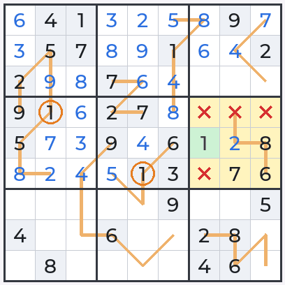

<!-- Written by tools/walkthrough.py entropic-lines: edit the script, not this page. -->
# Entropic Lines, step 26: the 1 in box 6

**Step 26 of 51** · [← Step 25](step-25.md) · [All steps](../entropic-lines.md#the-whole-puzzle-step-by-step) · [Step 27 →](step-27.md)

Box 6 needs a 1. r4c7, r4c8 and r4c9: row 4 has one (r4c2). r6c7: row 6 has one (r6c5). Only **r5c7** is left: **r5c7 = 1**.

**Step 26 of 51** · [← Step 25](step-25.md) · [All steps](../entropic-lines.md#the-whole-puzzle-step-by-step) · [Step 27 →](step-27.md)
