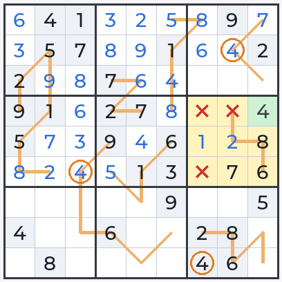

<!-- Written by tools/walkthrough.py entropic-lines: edit the script, not this page. -->
# Entropic Lines, step 27: the 4 in box 6

**Step 27 of 51** · [← Step 26](step-26.md) · [All steps](../entropic-lines.md#the-whole-puzzle-step-by-step) · [Step 28 →](step-28.md)

Box 6 needs a 4. r4c7: column 7 has one (r9c7). r4c8: column 8 has one (r2c8). r6c7: row 6 has one (r6c3). Only **r4c9** is left: **r4c9 = 4**.

**Step 27 of 51** · [← Step 26](step-26.md) · [All steps](../entropic-lines.md#the-whole-puzzle-step-by-step) · [Step 28 →](step-28.md)
