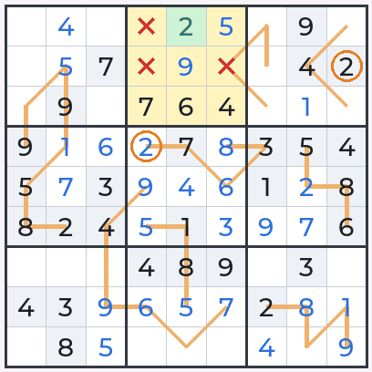

<!-- Written by tools/walkthrough.py entropic-lines: edit the script, not this page. -->
# Entropic Lines, step 28: the 3 in box 6

**Step 28 of 51** · [← Step 27](step-27.md) · [All steps](../entropic-lines.md#the-whole-puzzle-step-by-step) · [Step 29 →](step-29.md)

Box 6 needs a 3. r6c7: row 6 has one (r6c6). r4c8: it's 3 cells from the 6 in r6c9 along its orange line, so it's middle (4-6) like it. Only **r4c7** is left: **r4c7 = 3**.

**Step 28 of 51** · [← Step 27](step-27.md) · [All steps](../entropic-lines.md#the-whole-puzzle-step-by-step) · [Step 29 →](step-29.md)
