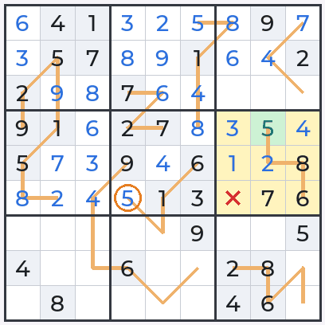

<!-- Written by tools/walkthrough.py entropic-lines: edit the script, not this page. -->
# Entropic Lines, step 29: the 5 in box 6

**Step 29 of 51** · [← Step 28](step-28.md) · [All steps](../entropic-lines.md#the-whole-puzzle-step-by-step) · [Step 30 →](step-30.md)

Box 6 needs a 5. r6c7: row 6 has one (r6c4). Only **r4c8** is left: **r4c8 = 5**.

**Step 29 of 51** · [← Step 28](step-28.md) · [All steps](../entropic-lines.md#the-whole-puzzle-step-by-step) · [Step 30 →](step-30.md)
