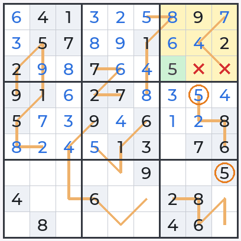

<!-- Written by tools/walkthrough.py entropic-lines: edit the script, not this page. -->
# Entropic Lines, step 30: the 5 in box 3

**Step 30 of 51** · [← Step 29](step-29.md) · [All steps](../entropic-lines.md#the-whole-puzzle-step-by-step) · [Step 31 →](step-31.md)

Box 3 needs a 5. r3c8: column 8 has one (r4c8). r3c9: column 9 has one (r7c9). Only **r3c7** is left: **r3c7 = 5**.

**Step 30 of 51** · [← Step 29](step-29.md) · [All steps](../entropic-lines.md#the-whole-puzzle-step-by-step) · [Step 31 →](step-31.md)
