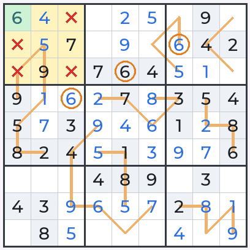

<!-- Written by tools/walkthrough.py entropic-lines: edit the script, not this page. -->
# Entropic Lines, step 31: the 9 in box 6

**Step 31 of 51** · [← Step 30](step-30.md) · [All steps](../entropic-lines.md#the-whole-puzzle-step-by-step) · [Step 32 →](step-32.md)

Box 6 needs a 9, and r6c7 is its last empty cell: **r6c7 = 9**.

**Step 31 of 51** · [← Step 30](step-30.md) · [All steps](../entropic-lines.md#the-whole-puzzle-step-by-step) · [Step 32 →](step-32.md)
