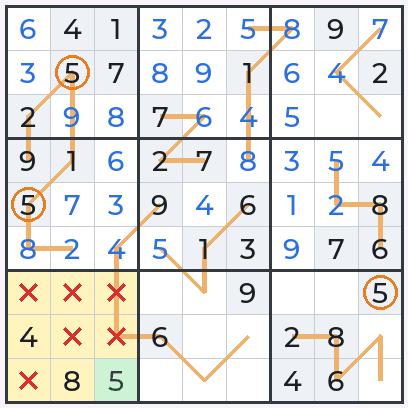

<!-- Written by tools/walkthrough.py entropic-lines: edit the script, not this page. -->
# Entropic Lines, step 32: the 5 in box 7

**Step 32 of 51** · [← Step 31](step-31.md) · [All steps](../entropic-lines.md#the-whole-puzzle-step-by-step) · [Step 33 →](step-33.md)

Box 7 needs a 5. r7c1, r7c2 and r7c3: row 7 has one (r7c9). r8c2: column 2 has one (r2c2). r9c1: column 1 has one (r5c1). r8c3: it's 3 cells from the 9 in r5c4 along its orange line, so it's high (7-9) like it. Only **r9c3** is left: **r9c3 = 5**.

**Step 32 of 51** · [← Step 31](step-31.md) · [All steps](../entropic-lines.md#the-whole-puzzle-step-by-step) · [Step 33 →](step-33.md)
