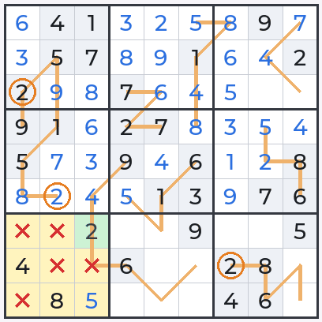

<!-- Written by tools/walkthrough.py entropic-lines: edit the script, not this page. -->
# Entropic Lines, step 33: the 2 in box 7

**Step 33 of 51** · [← Step 32](step-32.md) · [All steps](../entropic-lines.md#the-whole-puzzle-step-by-step) · [Step 34 →](step-34.md)

Box 7 needs a 2. r7c1 and r9c1: column 1 has one (r3c1). r7c2: column 2 has one (r6c2). r8c2 and r8c3: row 8 has one (r8c7). Only **r7c3** is left: **r7c3 = 2**.

**Step 33 of 51** · [← Step 32](step-32.md) · [All steps](../entropic-lines.md#the-whole-puzzle-step-by-step) · [Step 34 →](step-34.md)
