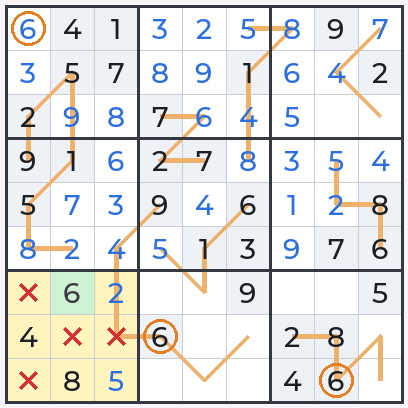

<!-- Written by tools/walkthrough.py entropic-lines: edit the script, not this page. -->
# Entropic Lines, step 34: the 6 in box 7

**Step 34 of 51** · [← Step 33](step-33.md) · [All steps](../entropic-lines.md#the-whole-puzzle-step-by-step) · [Step 35 →](step-35.md)

Box 7 needs a 6. r7c1: column 1 has one (r1c1). r8c2 and r8c3: row 8 has one (r8c4). r9c1: row 9 has one (r9c8). Only **r7c2** is left: **r7c2 = 6**.

**Step 34 of 51** · [← Step 33](step-33.md) · [All steps](../entropic-lines.md#the-whole-puzzle-step-by-step) · [Step 35 →](step-35.md)
