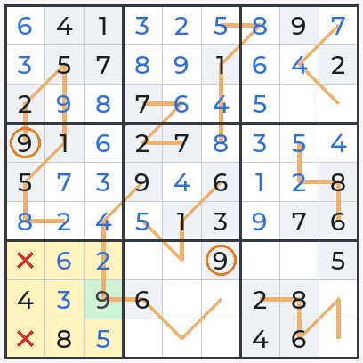

<!-- Written by tools/walkthrough.py entropic-lines: edit the script, not this page. -->
# Entropic Lines, step 36: the 9 in box 7

**Step 36 of 51** · [← Step 35](step-35.md) · [All steps](../entropic-lines.md#the-whole-puzzle-step-by-step) · [Step 37 →](step-37.md)

Box 7 needs a 9. r7c1: row 7 has one (r7c6). r9c1: column 1 has one (r4c1). Only **r8c3** is left: **r8c3 = 9**.

**Step 36 of 51** · [← Step 35](step-35.md) · [All steps](../entropic-lines.md#the-whole-puzzle-step-by-step) · [Step 37 →](step-37.md)
