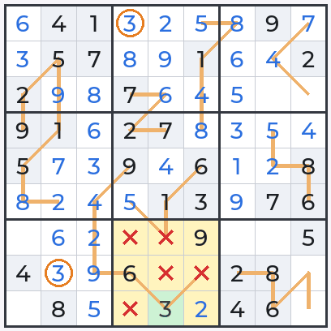

<!-- Written by tools/walkthrough.py entropic-lines: edit the script, not this page. -->
# Entropic Lines, step 38: the 3 in box 8

**Step 38 of 51** · [← Step 37](step-37.md) · [All steps](../entropic-lines.md#the-whole-puzzle-step-by-step) · [Step 39 →](step-39.md)

Box 8 needs a 3. r7c4 and r9c4: column 4 has one (r1c4). r8c5 and r8c6: row 8 has one (r8c2). r7c5: next to it on its orange line there's a low (1-3) and a middle (4-6) digit already, and three in a row need one of each. Only **r9c5** is left: **r9c5 = 3**.

**Step 38 of 51** · [← Step 37](step-37.md) · [All steps](../entropic-lines.md#the-whole-puzzle-step-by-step) · [Step 39 →](step-39.md)
