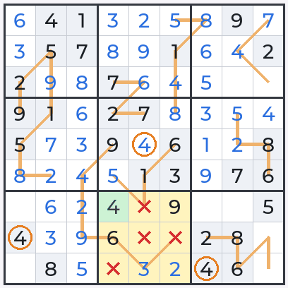

<!-- Written by tools/walkthrough.py entropic-lines: edit the script, not this page. -->
# Entropic Lines, step 39: the 4 in box 8

**Step 39 of 51** · [← Step 38](step-38.md) · [All steps](../entropic-lines.md#the-whole-puzzle-step-by-step) · [Step 40 →](step-40.md)

Box 8 needs a 4. r7c5: column 5 has one (r5c5). r8c5 and r8c6: row 8 has one (r8c1). r9c4: row 9 has one (r9c7). Only **r7c4** is left: **r7c4 = 4**.

**Step 39 of 51** · [← Step 38](step-38.md) · [All steps](../entropic-lines.md#the-whole-puzzle-step-by-step) · [Step 40 →](step-40.md)
