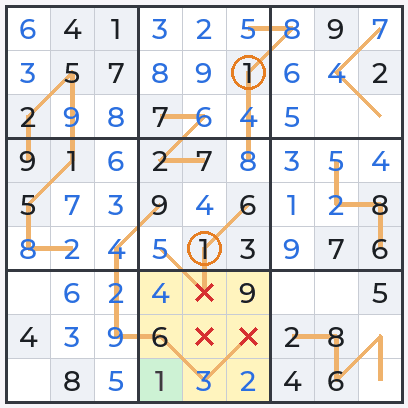

<!-- Written by tools/walkthrough.py entropic-lines: edit the script, not this page. -->
# Entropic Lines, step 40: the 1 in box 8

**Step 40 of 51** · [← Step 39](step-39.md) · [All steps](../entropic-lines.md#the-whole-puzzle-step-by-step) · [Step 41 →](step-41.md)

Box 8 needs a 1. r7c5 and r8c5: column 5 has one (r6c5). r8c6: column 6 has one (r2c6). Only **r9c4** is left: **r9c4 = 1**.

**Step 40 of 51** · [← Step 39](step-39.md) · [All steps](../entropic-lines.md#the-whole-puzzle-step-by-step) · [Step 41 →](step-41.md)
