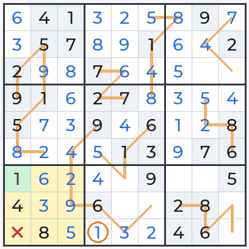

<!-- Written by tools/walkthrough.py entropic-lines: edit the script, not this page. -->
# Entropic Lines, step 41: the 1 in box 7

**Step 41 of 51** · [← Step 40](step-40.md) · [All steps](../entropic-lines.md#the-whole-puzzle-step-by-step) · [Step 42 →](step-42.md)

Box 7 needs a 1. r9c1: row 9 has one (r9c4). Only **r7c1** is left: **r7c1 = 1**.

**Step 41 of 51** · [← Step 40](step-40.md) · [All steps](../entropic-lines.md#the-whole-puzzle-step-by-step) · [Step 42 →](step-42.md)
