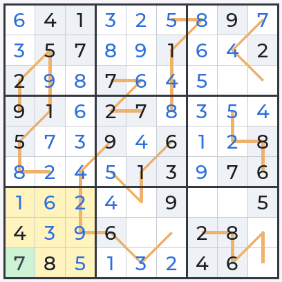

<!-- Written by tools/walkthrough.py entropic-lines: edit the script, not this page. -->
# Entropic Lines, step 42: the 7 in box 7

**Step 42 of 51** · [← Step 41](step-41.md) · [All steps](../entropic-lines.md#the-whole-puzzle-step-by-step) · [Step 43 →](step-43.md)

Box 7 needs a 7, and r9c1 is its last empty cell: **r9c1 = 7**.

**Step 42 of 51** · [← Step 41](step-41.md) · [All steps](../entropic-lines.md#the-whole-puzzle-step-by-step) · [Step 43 →](step-43.md)
