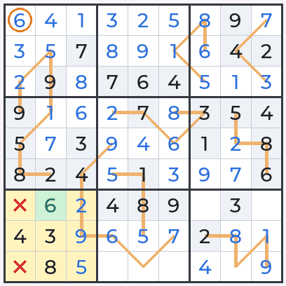

<!-- Written by tools/walkthrough.py entropic-lines: edit the script, not this page. -->
# Entropic Lines, step 43: the 5 in box 8

**Step 43 of 51** · [← Step 42](step-42.md) · [All steps](../entropic-lines.md#the-whole-puzzle-step-by-step) · [Step 44 →](step-44.md)

Box 8 needs a 5. r7c5: row 7 has one (r7c9). r8c6: column 6 has one (r1c6). Only **r8c5** is left: **r8c5 = 5**.

**Step 43 of 51** · [← Step 42](step-42.md) · [All steps](../entropic-lines.md#the-whole-puzzle-step-by-step) · [Step 44 →](step-44.md)
