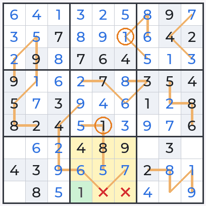

<!-- Written by tools/walkthrough.py entropic-lines: edit the script, not this page. -->
# Entropic Lines, step 44: the 7 in box 8

**Step 44 of 51** · [← Step 43](step-43.md) · [All steps](../entropic-lines.md#the-whole-puzzle-step-by-step) · [Step 45 →](step-45.md)

Box 8 needs a 7. r7c5: column 5 has one (r4c5). Only **r8c6** is left: **r8c6 = 7**.

**Step 44 of 51** · [← Step 43](step-43.md) · [All steps](../entropic-lines.md#the-whole-puzzle-step-by-step) · [Step 45 →](step-45.md)
